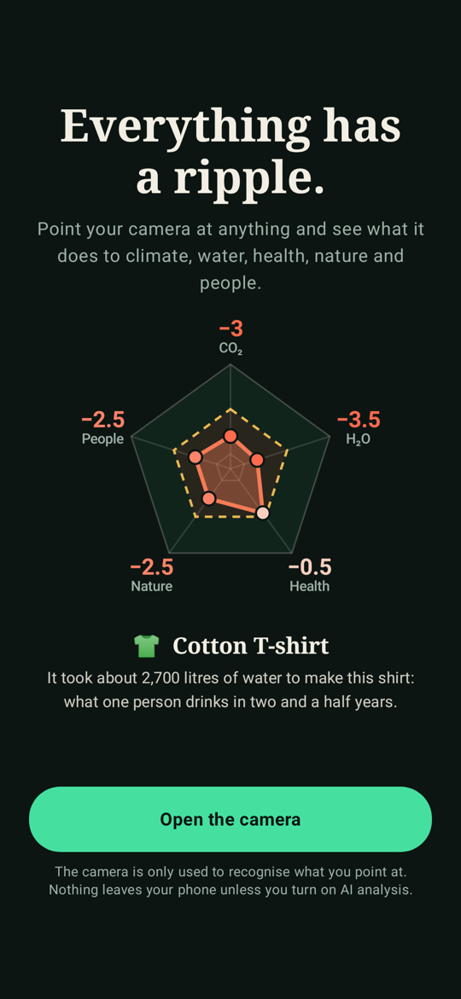
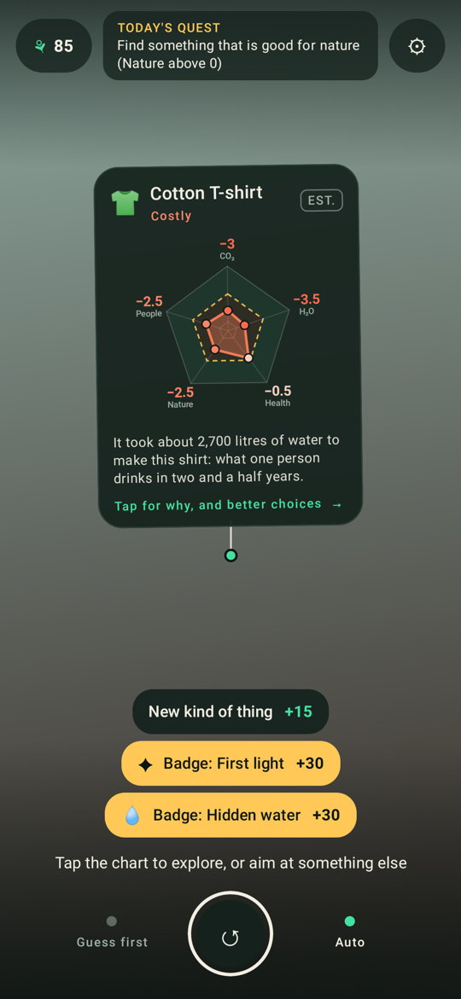
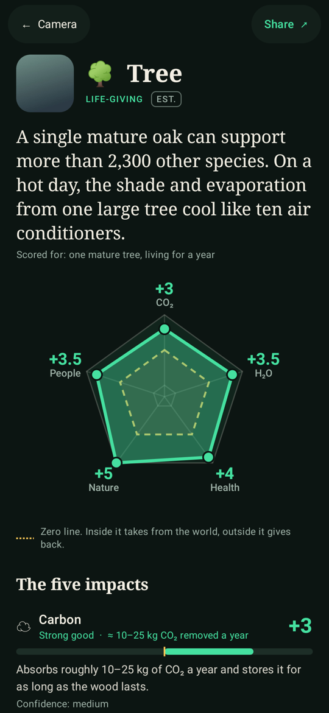
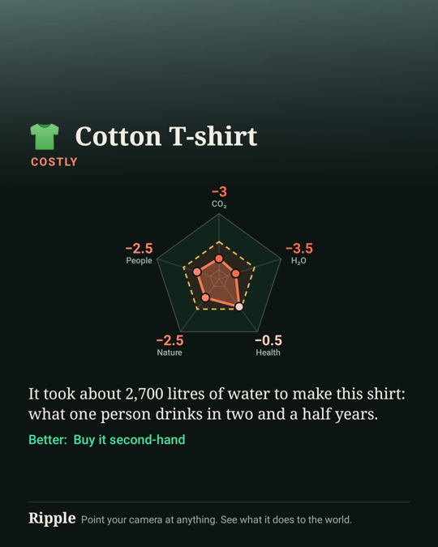

# Ripple

Point your phone camera at anything — a shoe, your lunch, a tree, a dog — and a five-axis chart
hangs off it showing what it does to the world:

**Carbon · Freshwater · Health · Nature & biodiversity · Social**, each scored from −5 to +5, where 0 means no meaningful impact.

| Welcome | Live scan | Deep dive | Share card |
|---|---|---|---|
|  |  |  |  |

## Get the app

Every push that touches `ripple/` builds an APK in GitHub Actions (workflow **Ripple**). Open the
run, download the `ripple-debug-apk` artifact, and install it on an Android 8+ phone. The same build is
published as the `ripple-latest` pre-release, whose `Ripple.apk` can be downloaded straight to a phone.

To build locally: `cd ripple && ./gradlew :app:assembleDebug` (JDK 17+ and the Android SDK).

## How it works

1. **See.** CameraX feeds frames to ML Kit's on-device object detector, which finds the most
   prominent object and gives it a tracking id. Brackets hug it; hold steady and they close.
2. **Identify and score**, in three tiers. Each replaces the one before when it arrives:
   - **On-device (instant, offline).** ML Kit labels are matched to a bundled library of 56 kinds
     of object, each with scores, reasons, life-cycle stages, dependencies, alternatives and sources.
   - **Barcode.** A food barcode is looked up in Open Food Facts: carbon from Agribalyse life-cycle
     data, health from Nutri-Score and NOVA, nature from Eco-Score. Freshwater and social are
     estimated from the category and marked low confidence.
   - **AI (optional).** With a Claude API key in Settings, a cropped photo is sent to Claude, which
     identifies the specific object and scores it against the same rubric. It also answers free-form
     follow-up questions.
3. **Hang the chart.** The chart is tethered to the tracked object with a spring, so it lags and
   sways as you move. The dashed ring is zero: a shape inside it takes, a shape outside it gives.
4. **Go deeper.** Tap the chart for the reasoning behind each score, where in its life the impact
   happens, what it depends on, better choices (each previewable on the chart), and questions.
5. **Act and share.** "I'll do this" adds a commitment to your journal with its yearly saving.
   Share renders a 1080×1350 card. You can compare any two scans on one chart.

What keeps people coming back: a daily quest that is the same for everyone, an optional
"guess first" round before each reveal, streaks, badges, and a level that grows from Seed to Forest.

## The scoring rubric

The rules live in one place, [`Rubric.kt`](core/src/main/kotlin/earth/ripple/core/Rubric.kt), and
all three tiers are held to them.

- A score is the net effect of the thing existing and being used the typical way, over its whole
  life, for one item, one serving, or one year of use.
- Carbon and freshwater are logarithmic. Carbon: 0.1 kg CO₂e → −1, 1 kg → −2, 10 kg → −3, 100 kg → −4,
  ≥ 1 t → −5. Freshwater: 10 L → −1 … ≥ 100,000 L → −5.
- Health, nature and social are anchored judgements (the anchors are in the rubric).
- Positive scores are for things that give back or displace something worse, and the assumption is
  stated each time (a bicycle is scored as replacing some car trips).
- Every score carries a confidence level and every object lists its sources.

These are estimates to build intuition, not an audit of a specific product.

## Layout

- `core/` — plain Kotlin, no Android: rubric, knowledge base (`src/main/resources/kb_*.json`),
  Open Food Facts mapping, AI prompt/schema/parser, game logic, chart geometry. `./gradlew :core:test`
- `app/` — the Android app (Jetpack Compose, CameraX, ML Kit, Anthropic Java SDK).
  `./gradlew :app:testDebugUnitTest` renders every screen to `app/build/screens/` without a device.

## Known limits and next steps

- **Not yet run on a physical phone.** It compiles, the logic is unit-tested and every screen has
  been rendered off-device, but camera, tracking and the AI call need a real-device pass.
- The chart is anchored in screen space to the tracked object, not to a 3D world anchor. ARCore
  anchoring would keep it fixed in the room when the object leaves the frame.
- The API key is entered by the user and stored encrypted on the phone. A public release should
  call the model through your own backend instead.
- The debug APK is large (about 95 MB) because it is unshrunk and bundles the vision models for
  every CPU type. A release build with code shrinking and per-ABI splits will be far smaller.
- On-device recognition only knows what ML Kit's general labeler knows. Without AI analysis,
  unusual objects fall back to a broad category, and the app says so.
